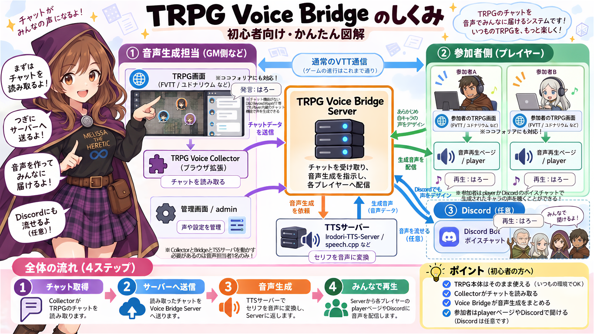
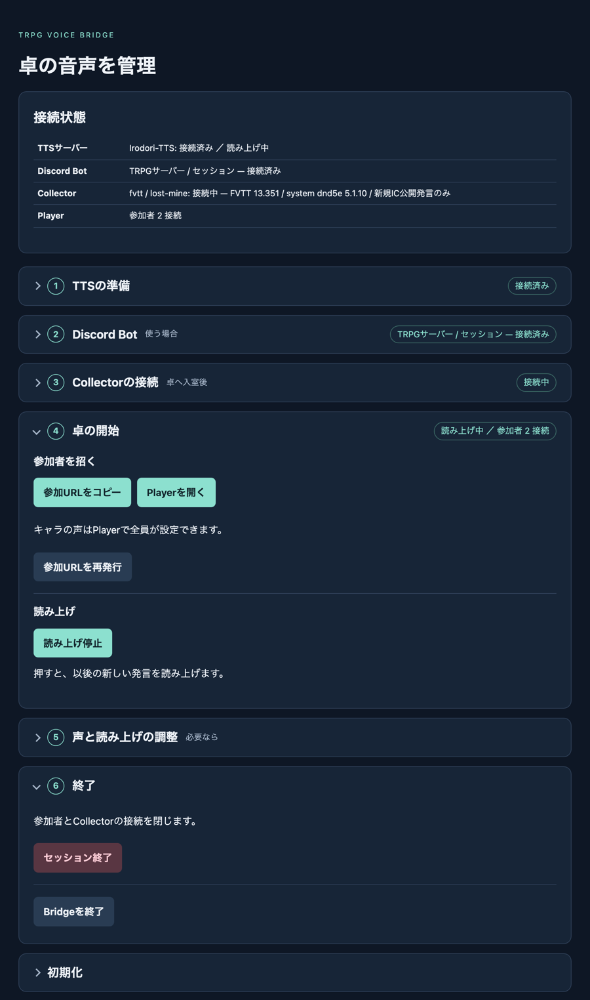
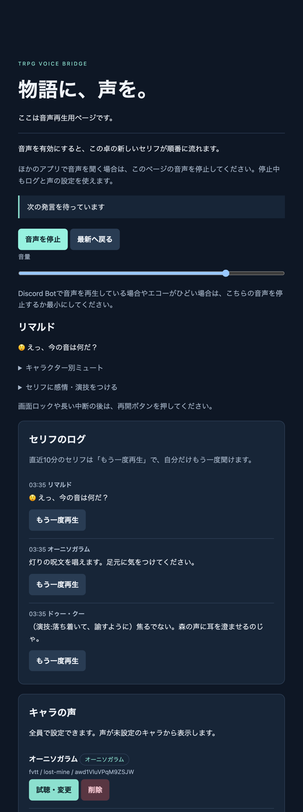
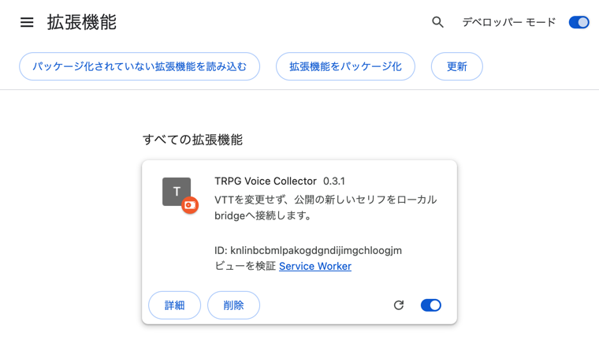
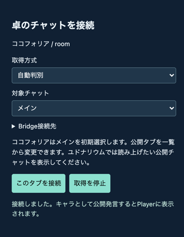

# TRPG Voice Bridge

FVTT・ユドナリウム・ココフォリアなどのVTTから、音声担当者（GMまたはPL）のブラウザ拡張で公開発言を取り込み、Irodori-TTS-Server（あるいはspeech.cpp）で発言の音声を生成して、参加者のブラウザへ、あるいはDiscord Bot経由で同じ音声を配るためのシステムです。



キャラの声はPlayerで全員が設定できます。Collectorの初回の承認と、読み上げの開始・停止は管理画面で行います。

チャット機能のないVTTでも、招待URLからPlayerを開き、キャラを作成・選択して直接発言できます。この使い方ではCollectorは不要です。チャット本文は保存され、TTSの準備前や読み上げ停止中でも会話できます。サイドパネル用の[Chatter拡張](tts-bridge/chatter/README.md)も利用できます。

システムメッセージやダイスだけの発言は読み上げません。ダイス付きのセリフはコマンドを除いた本文だけを読み上げ、結果は読みません。VTTごとの取得の条件は[セットアップガイド](docs/setup-guide.md#collectorとは)を見てください。

### 起動方法とビルド方法

ビルド済みアプリを使用する場合、[リリース情報](https://github.com/okamichi/trpg-voice-bridge/releases) のページから、対応OS用のZIPファイルをダウンロードしてください。
付属している [ダウンロードしたアプリの使い方](tts-bridge/packaging/README.txt) のドキュメントに従って起動してください。

ソースから使う場合は、[ソースからのビルドと起動](docs/build.md) のドキュメントに従ってビルドと起動を行ってください。

### 詳細情報

- [構成・Collector・声の登録（セットアップガイド）](docs/setup-guide.md)
- [各種コンポーネント説明](docs/component.md)
- [Bridgeの設定と動きの詳細](tts-bridge/README.md)
- [音声をDiscordで流す場合](docs/discord.md)
- [別のPCの参加者にPlayerを公開する場合](docs/online.md)

### TRPG-Voice-Bridge の紹介

https://github.com/user-attachments/assets/665cbcc9-6e3c-471d-a7fa-a81acc433b26

### クイックスタートガイド

https://github.com/user-attachments/assets/f966a54c-3858-4a38-a826-e887b3212dc1

## Irodori-TTS-Server について

音声の生成には[Irodori-TTS-Server](https://github.com/Aratako/Irodori-TTS-Server)を使います。日本語音声合成モデル[Irodori-TTS](https://github.com/Aratako/Irodori-TTS)を、OpenAIのText-to-Speech API互換で提供するサーバーです。Bridgeと同じマシンで`127.0.0.1:8088`に起動する構成を標準にしています。

Bridgeが使うIrodoriの機能は次のとおりです。

- **声の説明文による声づくり（Voice Design）**: 「落ち着いた年配の男性の声」のような説明文（caption）とseedで声を作ります。参照音声がなくても、キャラごとに声を作り分けられます。
- **参照音声による声の固定**: 参照音声を指定すると、その声質に寄せて生成します。Playerで試聴した声を、そのまま参照音声として登録できます。
- **発言ごとの演技指示**: 発言に書いた感情や演技の指示を反映して生成します（[書き方](#演技指示の書き方)）。

Irodori-TTS-Server の代わりに、同じAPIを実装した [speech.cpp](https://github.com/okamichi/speech.cpp) のフォークでも動かせます。現在、こちらの方がメモリ効率とパフォーマンスがよいです。

ダウンロードしたアプリにはこの speech.cpp が入っていて、管理画面からモデルをダウンロードして使えます。

### 推奨モデル

| モデル | ライセンス | 特徴 |
| :--- | :--- | :--- |
| [Aratako/Irodori-TTS-v4.1-Small](https://huggingface.co/Aratako/Irodori-TTS-v4.1-Small) | MIT | 標準的な小型モデル。生成が速く、手元のGPUやApple Siliconでも扱いやすいです。 |
| [phasefield-audio/Irodori-TTS-v4.1-Anime](https://huggingface.co/phasefield-audio/Irodori-TTS-v4.1-Anime) | MIT | v4.1-Smallをアニメ調の音声で追加学習したモデル。キャラクターらしい演技に向きます。説明文や絵文字の効き方はベースモデルと異なる場合があります。 |
| [Aratako/Irodori-TTS-v4-Large](https://huggingface.co/Aratako/Irodori-TTS-v4-Large) | Gemma | 約3.29Bパラメーターの大型モデル。説明文への追従性が高い一方、多くのメモリと生成時間が必要です。 |

ライセンスはモデルごとに異なります。v4-LargeはGemmaの利用規約に従います。

量子化版もあります。v4.1-Animeはリポジトリ内のサブフォルダーに、v4-Largeは[Aratako/Irodori-TTS-v4-Large-Quantized](https://huggingface.co/Aratako/Irodori-TTS-v4-Large-Quantized)に収録されています。量子化版はおもにNVIDIA CUDA向けです。

Apple Siliconで動かす場合は、MLXハイブリッド推論を追加したフォーク[okamichi/Irodori-TTS-Server](https://github.com/okamichi/Irodori-TTS-Server)の`mlx`ブランチを用意しています。

## 演技指示の書き方

VTTのチャットで、発言の中に絵文字か全角の丸カッコで指示を書きます。丸カッコの指示は読み上げから取り除かれます。

```text
（怒り）ふざけるな！（間）……もういい。
😲えっ、本当に？
（演技:震える声で、怯えながら）誰か……いるの？
```

- **感情・演技の切り替え**: 絵文字を直接書くか、`（単語）`と書きます。その文の中で、書いた位置から演技を切り替えます（複数の文を含むセリフは1文ずつ生成するため、次の文には引き継ぎません）。使える単語と絵文字は次のとおりです。
  喜び😆 怒り😠 悲しみ😭 驚き😲 心配😟 緊張😰 安堵😌 自信😎 照れ🫣 囁き・ささやき・小声👂 優しく🫶 笑い🤭 ため息😮‍💨 早口⏩ ゆっくり🐢 叫び😱 眠そう😪 懇願🙏 ナレーション📖 間⏸️（`通常`は指示なし）
- **自由な文章**: `（演技:説明）`または`（感情:説明）`と書くと、その発言全体の演技指示として生成します。管理画面の「5 声と読み上げの調整」にある「感情・演技の指定方法」で、声の説明文（caption）への「追記」（既定）、「声の説明より前に追加」、「置換」を選べます。置換は参照音声を使う声に適用し、参照音声を使わない声では追記します。指定のない発言は元の声の説明を使います。保存した声の説明は変更されず、単語・絵文字の指定方法にも影響しません。
- 上の単語でも`演技:`・`感情:`付きでもない丸カッコ（例：`（小さく笑う）`、`剣（つるぎ）`）は、本文として読み上げます。
- 指示は1つ100文字まで、自由な文章の合計は200文字までです。

効き方はモデルによって異なり、対応していないモデルもあります。絵文字の対応表は、Irodori-TTS-v4.1-Smallとv4-Largeの公式の表に合わせています。v4.1-Animeは独自の学習データで追加学習されているため、絵文字や説明文が表のとおりに効くとは限りません。上の表にない絵文字もそのままモデルに渡りますが、効くとは限りません。Playerの「試聴するセリフ」欄にも同じ書き方が使えるので、試聴して確かめてください。指示はVTTのチャット欄にはそのまま表示されます。

効きが悪いときは、Playerの声の設定画面にある「声の詳細設定」を調整して、試聴しながら確かめてください。CFGは上げすぎると音声が不自然になるため、少しずつ変えます。

- **説明CFG**（Irodoriの既定値3.0）: 上げると、声の説明文と`（演技:…）`の指示が効きやすくなります。
- **生成ステップ数**: 増やすと、生成は遅くなりますが安定しやすくなります。
- **seed**: 変えると、同じ設定でも別の生成結果になります。

## VTTのチャットから声を登録する

管理画面の「5 声と読み上げの調整」で「チャットによる登録機能を有効にする」をオンにすると、Playerを開かずに、発言したキャラの声を登録できます（最初はオフです）。

```text
（ブリッジ声登録）若くて透き通るような女性の声。
（ブリッジ声削除）
```

登録すると、声を生成して参照音声として保存し、発言したキャラに割り当てます。読み上げ中なら、「こんにちは。これからこの声でお話しします。」をPlayerと、接続中のDiscordのボイスチャンネルに流します。声削除は割り当てを外すだけで、キャラや声、参照音声のファイルは残ります。

細かい決まりは[セットアップガイド](docs/setup-guide.md#チャットから声を登録する)を見てください。

## スクリーンショット

### /admin 管理ページ

音声担当者が使う画面です。ページ上部の「接続状態」で、TTS・Discord Bot・Collector・Playerの状態をまとめて確認することができます。
その下に、設定する順に手順が並びます。各手順の右端に状態が出て、対応が必要な手順だけが開いた状態で表示されます。



### /player 卓音声再生・キャラ声紐付けページ

参加者が音声を聞き、セリフのログを確かめ、キャラの声を設定する画面です。ログのセリフは、自分だけもう一度再生できます。

「登録済みの声を整理」を開くと、登録数（最大500件）と、声の名前・使っているキャラ・試聴・削除の一覧を表示します。使っていない声だけ、確認したうえで削除できます。



### ブラウザ拡張（Collector）

音声担当者のChromeに読み込んだCollectorです。



VTTのタブでCollectorを開き、「このタブを接続」を押したところです。初回は確認コードが表示されるので、管理画面で承認してから、もう一度押します。




## 利用上の注意

- 実在の人物（声優・著名人など）の声や、版権作品のキャラクターの声を、本人や権利者の許可なく参照音声として登録・使用しないでください。
- そのような声で生成した音声や、それを含む録画・配信などを公開しないでください。
- 使用するモデルのライセンスと利用制限に従ってください（各モデルカードの記載、v4-LargeはGemmaの利用規約）。
- 本ソフトウェアの利用によって生じたいかなる損害についても、作者は責任を負いません（[LICENSE](LICENSE)も参照）。

## チャットデータについて

- 本ツールは、ブラウザ拡張（Collector）を使用して、対応するTRPGオンラインセッションツールの画面上に表示されたチャットデータを取得し、音声読み上げに利用します。
- Collectorは上記の参照目的のみで動作し、セッションツールへのチャット送信やゲームデータの変更は行いません。生成された音声は卓の参加者間で共有・再生されます。

## ライセンス

MITライセンスです。全文は[LICENSE](LICENSE)を参照してください。
