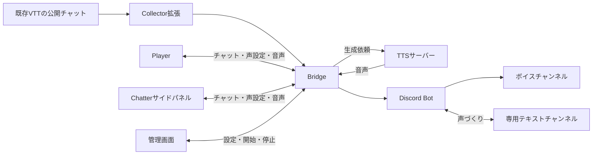

# 構成と使い分け

卓の発言を入力し、声を生成し、参加者へ届けるための部品を説明します。実際の導入は[セットアップガイド](setup-guide.md)へ進んでください。

## 全体の流れ

Player・Chatterから直接発言する場合、Collectorは不要です。TTSを使わずに文字だけで会話することもできます。

## 音声担当者と参加者

**音声担当者**はBridgeとTTSを動かし、管理画面で接続・読み上げ・参加URLを管理します。GMでもPLでも担当でき、VTTのGM権限は必須ではありません。既存チャットを取り込む担当者は、同じチャットにつき一人にします。

**参加者**はPlayer・Chatterで声を設定し、チャットや再生を利用します。既存VTTのチャットを使ってDiscordで聞く場合は、Playerを開かずに参加することもできます。

## 各部品の役割

| 部品        | 動かす場所                         | 主な役割                                                           |
| ----------- | ---------------------------------- | ------------------------------------------------------------------ |
| Bridge      | 音声担当者のPC                     | キャラと声を管理し、音声生成を依頼して参加者へ配信する             |
| 管理画面    | 音声担当者のブラウザ               | TTS・Collector・Discordの接続、読み上げの開始・停止、参加URLの発行 |
| TTS         | 同じPC、または別途用意したサーバー | Irodoriモデルから音声を生成する                                    |
| Collector   | 音声担当者のChrome                 | 接続したVTTタブの新しい公開キャラ発言をBridgeへ送る                |
| Player      | 参加者のブラウザ                   | チャット、声の共同編集、音声再生                                   |
| Chatter     | 利用する参加者のChrome（116以上）  | Playerに相当する機能をVTTの横のサイドパネルで使う                  |
| Discord Bot | BridgeからDiscordへ接続            | VCへ音声を流し、専用テキストチャンネルで声づくりを行う             |

管理画面とPlayerはBridgeが配信するページです。参加者がそれぞれWebサーバーやTTSを用意する必要はありません。ChatterはVTTへチャット機能を注入せず、独立したBridgeのチャットを表示します。

## チャットと再生先を選ぶ

| 入力する場所        | 聞く場所   | 必要なもの                                            |
| ------------------- | ---------- | ----------------------------------------------------- |
| 対応VTTのチャット   | ブラウザ   | Bridge・TTS・Collector、参加者のPlayerまたはChatter   |
| 対応VTTのチャット   | Discord VC | Bridge・TTS・Collector・Discord Bot                   |
| Playerのチャット    | ブラウザ   | Bridge・TTS、参加者のPlayer                           |
| Chatterのチャット   | ブラウザ   | Bridge・TTS、使う参加者のChatter                      |
| PlayerまたはChatter | Discord VC | Bridge・TTS・Discord Bot、参加者のPlayerまたはChatter |
| PlayerまたはChatter | 文字だけ   | Bridge、参加者のPlayerまたはChatter                   |

VTTとPlayer・Chatterの発言は、同じ卓の履歴へ集まります。Player・Chatterの投稿をVTTへ送り返す機能はありません。

ブラウザとDiscordで同時に音声を有効にすると二重に聞こえます。参加者ごとに聞く場所を一つ選びます。ブラウザごとのミュートはDiscord Botへ反映されません。

## TTSを選ぶ

| 項目           | 内蔵speech.cpp               | 外部speech.cpp                      | 外部Irodori-TTS-Server・互換フォーク                           |
| -------------- | ---------------------------- | ----------------------------------- | -------------------------------------------------------------- |
| 利用するBridge | 配布アプリ                   | アプリ・ソース起動                  | アプリ・ソース起動                                             |
| 起動・停止     | Bridgeが行う                 | 利用者が別に行う                    | 利用者が別に行う                                               |
| モデル指定     | 管理画面から取得・選択       | TTS側で指定                         | TTS側で指定                                                    |
| 接続先の種類   | Bridgeが本家speech.cppを選ぶ | 「speech.cpp（本家）」              | 「Irodori-TTS-Server / speech.cpp互換フォーク」                |
| 参照音声       | Bridgeが元WAVを保存して復元  | Bridgeが元WAVを保存して不足分を登録 | TTS側の保存機能を利用。Bridgeから登録した元WAVはBridgeにも保存 |

外部とはBridgeが起動管理しない意味で、同じPC上の別プロセスも含みます。また、本家speech.cppの参照音声の登録にはローカル接続が必要です。

内蔵のspeech.cppではモデル読込後に管理対象の音声を一括確認・復元し、それから準備完了になります。外部では生成に使う音声を生成前に確認し、不足分を復元します。全件の確認・復元は管理画面から実行できます。

## Bridgeを公開するか

参加者が別PCからPlayer・Chatterへ接続するには、[待ち受けと公開Origin](online.md)の設定が必要です。管理画面とCollectorは、音声担当者のローカルURLを使います。TTSを参加者へ公開する必要はありません。

既存VTTのチャットをCollectorで取り込み、Discordで聞くなら、Bridgeの公開は不要です。声設定も、音声担当者のPlayer、VTTの即時登録コマンド、Discordの声づくりフォームから行えます。

## データを置く場所

卓の設定・キャラ・声の割り当て・履歴はBridgeの保存先に置きます。Bridgeが登録した参照音声もここへ保存します。モデルの保存先と、外部TTS独自の参照音声の保存先は別に扱います。

卓ごとに保存先を分けると、キャラや設定を切り替えられます。保存先の変更だけではデータは移動しません。[保存・バックアップ](setup-guide.md#保存とバックアップ)を確認してください。

## コンポーネント詳細

### Collector

Collectorは、Chromeの機能拡張(同じアーキテクチャのブラウザのEdgeでも動作する可能性あり)で、Chromeブラウザにインストールして使用します。

CollectorはFoundryVTTやユドナリウム、ココフォリアなどのメインのチャットを監視し、キャラの新しい発言があれば、そのセリフデータを取得し、Bridgeサーバに送信する役割があります。

| 項目 | 内容 |
| --- | --- |
| 役割 | VTTのチャットにある新しい公開キャラ発言を、Bridgeへ送る |
| 対応VTT | FVTT（12・13・14）、ユドナリウム with Fly、ユドナリウム（従来方式）、ココフォリア |
| 動かす場所 | 音声担当者のChrome（拡張機能）。Bridgeと同じPCで動かす |
| 使う人 | 同じチャットにつき、音声担当者1人だけ |
| 入手 | ダウンロードしたアプリの `collector/`、またはソースの `tts-bridge/collector/` を、`chrome://extensions` で読み込む |
| 接続 | VTTのタブで接続する。初回は、拡張に表示された確認コードを管理画面「3 Collectorの接続」で承認する |

- 接続した後の新しい発言だけを送ります。表示済みの履歴、ささやき・シークレット・ダイスだけの発言などは読み上げません（詳細は [Collectorとは](setup-guide.md#collectorとは)）。
- チャットのないVTTでは、チャットの内容を取得する必要がないため、利用しません。

### Bridge 管理画面

Bridgeを起動すると開く画面です。ここで音声生成担当者はBridge全般の設定を行います。

| 項目 | 内容 |
| --- | --- |
| 役割 | Bridgeの設定・状態の確認と、卓の運営 |
| 開く場所 | 音声担当者のブラウザで `http://127.0.0.1:8090/admin/`。起動時に管理用リンクが自動で開く。外のアドレスからは開けない |
| 使う人 | 音声担当者だけ。管理用リンクは共有しない |

番号順に設定してください。

0. **起動設定** : 保存する場所などを設定
1. **TTSの準備**：外部TTSの接続先、または内蔵TTSの起動方式とモデル
2. **Discord Bot**：Botのトークンとボイスチャンネル（使う場合だけ）
3. **Collectorの接続**：VTTの既存チャットを取り込む場合だけ
4. **卓の開始**：参加URL（招待リンク）のコピー・再発行、Playerを開く、読み上げの開始・停止
5. **声と読み上げの調整**：チャットによる声登録、長いセリフの分割、チャットと本文の共有、卓のチャット履歴の消去
6. **終了**：セッション終了、Bridgeの終了

### Player

| 項目 | 内容 |
| --- | --- |
| 役割 | キャラとしてのチャット、キャラの声の設定・試聴、音声の再生 |
| 開く場所 | 参加者のブラウザで、管理画面から受け取った参加URL（`/player/#invite=…`）を開く |
| 使う人 | 参加者それぞれ。音声担当者も使う |
| 導入 | 不要。URLを開くだけ |

- チャット：「＋キャラ作成」でキャラを作り、発言キャラを選んで送信します。画面には最新100件までを表示します。
- 声の設定：「キャラ・声設定」で声を選び、試聴して保存します。試聴の音は本人にだけ聞こえます。
- 再生：「音声を有効にする」を押した画面だけで音声が鳴ります。音量、キャラクター別ミュート、「もう一度再生」（押した本人にだけ流れる）があります。
- 「Chatterの導入について」から、Chatter拡張のZIPをダウンロードできます。

### Chatter

| 項目 | 内容 |
| --- | --- |
| 役割 | Playerと同じ機能（チャット・声設定・音声再生）を、ChromeのサイドパネルでVTTの隣に表示する |
| 動かす場所 | 参加者のChrome（拡張機能。Chrome 116以上） |
| 使う人 | サイドパネルで使いたい参加者それぞれ |
| 入手 | Playerの「Chatterの導入について」からZIPをダウンロードして展開する。ダウンロードしたアプリの `chatter/` も使える。MacとWindowsで同じファイル |
| 接続 | パネルに招待リンクを貼って「参加」を押し、接続先へのアクセスを許可する |

- PlayerをiframeでVTTに埋め込んでいるのではなく、Playerと共通のコードを拡張に同梱しています。
- パネルを閉じると通信と再生が止まります。ブラウザを終了したら、招待リンクで参加し直します。
- Bridgeを更新したら、ZIPをダウンロードし直して読み込み直します。

### Discord Bot

DiscordのAPIを利用して、あらかじめ作成したDiscord Bot に接続し、ボイスチャンネルで生成した声を流します。また、簡易的なキャラクターの声のデザイン機能も備えています。

| 項目 | 内容 |
| --- | --- |
| 役割 | Bridgeが作った音声を、Discordのボイスチャンネルで流す |
| 動かす場所 | Bridgeの中（Bridgeのプロセスが、Botとしてログインする） |
| 準備 | Discord Developer PortalでBotを作り、サーバーに招待する。管理画面「2 Discord Bot」にトークンを入れて、ボイスチャンネルに接続する（[Discordでの利用方法](discord.md)） |
| 導入 | ダウンロードしたアプリは不要。ソースから使う場合は `npm --prefix discord ci` |

- 入室・退出のメッセージを流せます。
- Discordで聞く参加者は、PlayerやChatterで「音声を有効にする」を押しません。

## 利用パターン別の組み合わせ

✓＝必要、△＝場合による、－＝不要。管理画面とBridgeは、どのパターンでも必要です。

| # | パターン | Collector | Player | Chatter | Discord Bot | TTS | Bridgeの公開 |
| --- | --- | --- | --- | --- | --- | --- | --- |
| 1 | チャットのあるVTT・各自のブラウザで聞く | ✓（音声担当者） | ✓（全員：声設定・再生） | － | － | ✓ | 別のPCの参加者がいれば必要 |
| 2 | チャットのあるVTT・Discordで聞く | ✓（音声担当者） | △（声の設定） | － | ✓ | ✓ | 不要にできる |
| 3 | チャットのないVTT・Playerで会話 | － | ✓（全員：発言・声設定・再生） | － | － | ✓ | 別のPCの参加者がいれば必要 |
| 4 | チャットのないVTT・Chatterで会話 | － | △（Chatterの入手） | ✓（全員） | － | ✓ | 別のPCの参加者がいれば必要 |
| 5 | チャットのないVTT・Discordで聞く | － | PlayerかChatterで発言・声設定 | 〃 | ✓ | ✓ | 別のPCの参加者がいれば必要 |
| 6 | 文字のチャットだけ（読み上げない） | － | PlayerかChatterで発言 | 〃 | － | － | 別のPCの参加者がいれば必要 |

### 1. チャットのあるVTT・各自のブラウザで聞く（基本の形）

FVTT・ユドナリウム・ココフォリアなどで、VTTのチャットの発言を読み上げます。

- 音声担当者：Bridge・TTSを起動し、Collectorで VTTのタブを接続する。参加URLを配り、「読み上げ開始」を押す。
- 参加者：参加URLでPlayerを開き、「音声を有効にする」を押す。自分のキャラの声を設定する。発言はVTTのチャットで行う。

### 2. チャットのあるVTT・Discordで聞く

音声はDiscord Botだけで流します。Bridgeをインターネットに公開しなくても使えます。

- 声の設定は、次のどちらかで行います。
  - 音声担当者が、自分のPlayerで全員のキャラの声を設定する。
  - 管理画面で「チャットによる登録機能を有効にする」をオンにし、参加者がVTTのチャットで `（ブリッジ声登録）…` と発言して登録する。
- 参加者に自分のPlayerで声を設定してもらう場合は、パターン1と同じくBridgeの公開が必要です。
- 参加者はPlayerの音声を有効にしません。

### 3. チャットのないVTT・Playerで会話

D&D Beyond Mapsなど、チャット機能のないVTTで、Playerのチャットで会話します。Collectorは要りません。

- 音声担当者：Bridge・TTSを起動し、「4 卓の開始」で参加URLを配る。
- 参加者：参加URLでPlayerを開き、「＋キャラ作成」でキャラを作って発言する。声を設定し、聞く人は「音声を有効にする」を押す。
- VTTとPlayerは、別のタブかウィンドウで並べます。

### 4. チャットのないVTT・Chatterで会話

パターン3と同じことを、VTTの隣のサイドパネルで行います。

- 参加者は、Playerの「Chatterの導入について」からZIPを入手して読み込み、招待リンクで参加する。
- PlayerとChatterは、参加者ごとに選べます。混在しても、発言とログは共有されます。
- 同じ人がPlayerとChatterの両方で音声を有効にすると、二重に聞こえます。

### 5. チャットのないVTT・Discordで聞く

会話はPlayerかChatter、音声はDiscord Botで流します。

- 参加者はPlayer・Chatterで発言と声の設定を行い、音声は有効にしません。
- PlayerやChatterで発言するには参加者がBridgeにつながる必要があるので、別のPCの参加者がいる場合はBridgeの公開が必要です。

### 6. 文字のチャットだけ（読み上げない）

TTSを用意せず、PlayerかChatterのチャットだけを使います。TTSが未接続でも、本文の送受信と保存は行われます。後からTTSを用意して読み上げを始めることもできます。

### 補足：チャットのあるVTTでPlayer・Chatterのチャットも使う

パターン1・2でも、PlayerとChatterのチャットは使えます。Collectorで取り込んだ発言のうち共有対象のものは、Player・Chatterのチャットと同じ履歴に入ります。

