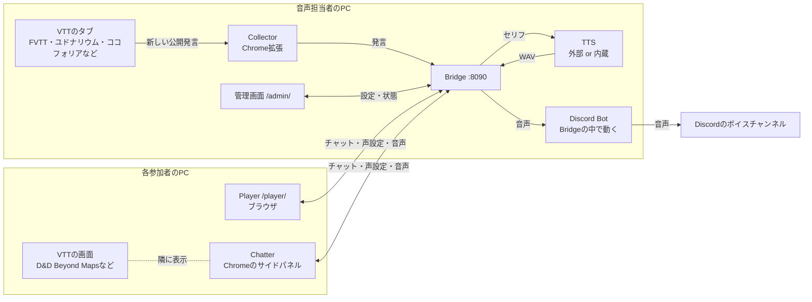

# 各コンポーネントと組み合わせ

TRPG Voice Bridgeを構成する部品の役割と、使い方ごとにどの部品が必要かをまとめます。

## 全体像

```text
[音声担当者のPC]
  TTS（外部 or 内蔵） <--セリフ・WAV--> Bridge :8090 <--設定・状態-- 管理画面（音声担当者）
                                          ^  ^  |
          VTTのタブ --新しい公開発言--> Collector  |  +--音声--> Discord Bot --> ボイスチャンネル
                                             |  |
[各参加者のPC]                               |  |
  ブラウザ: Player /player/ <--チャット・声設定・音声--+
  Chrome:   Chatter（サイドパネル） <--チャット・声設定・音声--+
```



- Bridgeが中心です。ほかの部品はすべてBridgeにつながります。
- Collectorは「VTTのチャットを取り込む」入口、PlayerとChatterは「Bridge自身のチャットで発言する」入口の役目があります。
- 音声の出口は、Player・Chatter・Discord Botの3つあります。

## コンポーネント

### Bridge

| 項目 | 内容 |
| --- | --- |
| 役割 | 発言を受け取り、キャラの声を選んでTTSに音声を作らせ、Player・Chatter・Discord Botに配る。管理画面とPlayerのページも配信する |
| 動かす場所 | 音声担当者のPC。既定は `http://127.0.0.1:8090` |
| 起動 | ダウンロードしたアプリは `trpg-voice-bridge`（Windowsは `.exe`）。ソースからは `tts-bridge/` で `npm start` |
| 保存するもの | 保存先（`--data-dir`）の `bridge.sqlite` に、設定・キャラ・声と、チャット本文（直近7日・卓ごとに最大10,000件）。音声のWAVは `audio/` の一時ファイル |
| 公開 | 既定では同じPCからしか開けない。別のPCの参加者にPlayer・Chatterを使わせるときは、`TTS_BRIDGE_HOST` と `TTS_PUBLIC_ORIGIN` を指定して起動する（[Playerの公開](online.md)） |

外のアドレスから使えるのは、PlayerとChatterの参加者用の機能だけです。管理画面とCollectorの接続は、`127.0.0.1` でしか受け付けません。

### TTSサーバー（外部・内蔵）

セリフから音声（WAV）を作ります。Bridgeとは別の部品で、外部と内蔵のどちらかを使います。

| | 外部TTS | 内蔵TTS |
| --- | --- | --- |
| 中身 | Bridgeとは別に起動した Irodori-TTS-Server か speech.cpp（フォーク版） | アプリに同梱した speech.cpp（フォーク版） |
| 起動 | 別のターミナルで自分で起動・停止する | Bridgeが起動・停止する |
| 使える起動方法 | ソースから（`npm start`）でも、ダウンロードしたアプリでも | ダウンロードしたアプリ（または自分で作った実行ファイル）だけ。`npm start` では使えない |
| 設定 | 管理画面「1 TTSの準備」の「Irodori接続先」（既定 `http://127.0.0.1:8088`） | 管理画面「1 TTSの準備」→「TTSの起動設定」で起動方式を「内蔵speech.cpp」にし、モデルをダウンロードする。Windowsは「Vulkan」（GPUあり）か「CPU」 |
| 参照音声の保存先 | 外部TTSの側（speech.cppなら `--voices-dir`） | Bridgeの保存先の `voices/` |

- どちらも、外に公開しません。内蔵TTSは `127.0.0.1` だけで待ち受けます。外部TTSも `--host 127.0.0.1` で起動します。
- 読み上げを使わず文字のチャットだけなら、TTSは要りません。TTSが未接続でも、チャット本文は届きます。

### Collector

| 項目 | 内容 |
| --- | --- |
| 役割 | VTTのチャットにある新しい公開キャラ発言を、Bridgeへ送る |
| 対応VTT | FVTT（12・13・14）、ユドナリウム with Fly、ユドナリウム（従来方式）、ココフォリア |
| 動かす場所 | 音声担当者のChrome（拡張機能）。Bridgeと同じPCで動かす |
| 使う人 | 同じチャットにつき、音声担当者1人だけ |
| 入手 | ダウンロードしたアプリの `collector/`、またはソースの `tts-bridge/collector/` を、`chrome://extensions` で読み込む |
| 接続 | VTTのタブで接続する。初回は、拡張に表示された確認コードを管理画面「3 Collectorの接続」で承認する |

- 接続した後の新しい発言だけを送ります。表示済みの履歴、ささやき・シークレット・ダイスだけの発言などは読み上げません（詳細は [Collectorとは](setup-guide.md#collectorとは)）。
- チャットのないVTTでは使いません。

### 管理画面

| 項目 | 内容 |
| --- | --- |
| 役割 | Bridgeの設定・状態の確認と、卓の運営 |
| 開く場所 | 音声担当者のブラウザで `http://127.0.0.1:8090/admin/`。起動時に管理用リンクが自動で開く。外のアドレスからは開けない |
| 使う人 | 音声担当者だけ。管理用リンクは共有しない |

手順の番号順に使います。

1. **TTSの準備**：外部TTSの接続先、または内蔵TTSの起動方式とモデル
2. **Discord Bot**：Botのトークンとボイスチャンネル（使う場合だけ）
3. **Collectorの接続**：VTTの既存チャットを取り込む場合だけ
4. **卓の開始**：参加URL（招待リンク）のコピー・再発行、Playerを開く、読み上げの開始・停止
5. **声と読み上げの調整**：チャットによる声登録、長いセリフの分割、チャットと本文の共有、卓のチャット履歴の消去
6. **終了**：セッション終了、Bridgeの終了

### Player

| 項目 | 内容 |
| --- | --- |
| 役割 | キャラとしてのチャット、キャラの声の設定・試聴、音声の再生 |
| 開く場所 | 参加者のブラウザで、管理画面から受け取った参加URL（`/player/#invite=…`）を開く |
| 使う人 | 参加者それぞれ。音声担当者も使う |
| 導入 | 不要。URLを開くだけ |

- チャット：「＋キャラ作成」でキャラを作り、発言キャラを選んで送信します。画面には最新100件までを表示します。
- 声の設定：「キャラ・声設定」で声を選び、試聴して保存します。試聴の音は本人にだけ聞こえます。
- 再生：「音声を有効にする」を押した画面だけで音声が鳴ります。音量、キャラクター別ミュート、「もう一度再生」（押した本人にだけ流れる）があります。
- 「Chatterの導入について」から、Chatter拡張のZIPをダウンロードできます。

### Chatter

| 項目 | 内容 |
| --- | --- |
| 役割 | Playerと同じ機能（チャット・声設定・音声再生）を、ChromeのサイドパネルでVTTの隣に表示する |
| 動かす場所 | 参加者のChrome（拡張機能。Chrome 116以上） |
| 使う人 | サイドパネルで使いたい参加者それぞれ |
| 入手 | Playerの「Chatterの導入について」からZIPをダウンロードして展開する。ダウンロードしたアプリの `chatter/` も使える。MacとWindowsで同じファイル |
| 接続 | パネルに招待リンクを貼って「参加」を押し、接続先へのアクセスを許可する |

- PlayerをiframeでVTTに埋め込んでいるのではなく、Playerと共通のコードを拡張に同梱しています。
- パネルを閉じると通信と再生が止まります。ブラウザを終了したら、招待リンクで参加し直します。
- Bridgeを更新したら、ZIPをダウンロードし直して読み込み直します。

### Discord Bot

| 項目 | 内容 |
| --- | --- |
| 役割 | Bridgeが作った音声を、Discordのボイスチャンネルで流す |
| 動かす場所 | Bridgeの中（Bridgeのプロセスが、Botとしてログインする） |
| 準備 | Discord Developer PortalでBotを作り、サーバーに招待する。管理画面「2 Discord Bot」にトークンを入れて、ボイスチャンネルに接続する（[Discordでの利用方法](discord.md)） |
| 導入 | ダウンロードしたアプリは不要。ソースから使う場合は `npm --prefix discord ci` |

- 入室・退出のメッセージを流せます。
- Discordで聞く参加者は、PlayerやChatterで「音声を有効にする」を押しません。

## 利用パターン別の組み合わせ

✓＝必要、△＝場合による、－＝不要。管理画面とBridgeは、どのパターンでも必要です。

| # | パターン | Collector | Player | Chatter | Discord Bot | TTS | Bridgeの公開 |
| --- | --- | --- | --- | --- | --- | --- | --- |
| 1 | チャットのあるVTT・各自のブラウザで聞く | ✓（音声担当者） | ✓（全員：声設定・再生） | － | － | ✓ | 別のPCの参加者がいれば必要 |
| 2 | チャットのあるVTT・Discordで聞く | ✓（音声担当者） | △（声の設定） | － | ✓ | ✓ | 不要にできる |
| 3 | チャットのないVTT・Playerで会話 | － | ✓（全員：発言・声設定・再生） | － | － | ✓ | 別のPCの参加者がいれば必要 |
| 4 | チャットのないVTT・Chatterで会話 | － | △（Chatterの入手） | ✓（全員） | － | ✓ | 別のPCの参加者がいれば必要 |
| 5 | チャットのないVTT・Discordで聞く | － | PlayerかChatterで発言・声設定 | 〃 | ✓ | ✓ | 別のPCの参加者がいれば必要 |
| 6 | 文字のチャットだけ（読み上げない） | － | PlayerかChatterで発言 | 〃 | － | － | 別のPCの参加者がいれば必要 |

### 1. チャットのあるVTT・各自のブラウザで聞く（基本の形）

FVTT・ユドナリウム・ココフォリアなどで、VTTのチャットの発言を読み上げます。

- 音声担当者：Bridge・TTSを起動し、Collectorで VTTのタブを接続する。参加URLを配り、「読み上げ開始」を押す。
- 参加者：参加URLでPlayerを開き、「音声を有効にする」を押す。自分のキャラの声を設定する。発言はVTTのチャットで行う。

### 2. チャットのあるVTT・Discordで聞く

音声はDiscord Botだけで流します。Bridgeをインターネットに公開しなくても使えます。

- 声の設定は、次のどちらかで行います。
  - 音声担当者が、自分のPlayerで全員のキャラの声を設定する。
  - 管理画面で「チャットによる登録機能を有効にする」をオンにし、参加者がVTTのチャットで `（ブリッジ声登録）…` と発言して登録する。
- 参加者に自分のPlayerで声を設定してもらう場合は、パターン1と同じくBridgeの公開が必要です。
- 参加者はPlayerの音声を有効にしません。

### 3. チャットのないVTT・Playerで会話

D&D Beyond Mapsなど、チャット機能のないVTTで、Playerのチャットで会話します。Collectorは要りません。

- 音声担当者：Bridge・TTSを起動し、「4 卓の開始」で参加URLを配る。
- 参加者：参加URLでPlayerを開き、「＋キャラ作成」でキャラを作って発言する。声を設定し、聞く人は「音声を有効にする」を押す。
- VTTとPlayerは、別のタブかウィンドウで並べます。

### 4. チャットのないVTT・Chatterで会話

パターン3と同じことを、VTTの隣のサイドパネルで行います。

- 参加者は、Playerの「Chatterの導入について」からZIPを入手して読み込み、招待リンクで参加する。
- PlayerとChatterは、参加者ごとに選べます。混在しても、発言とログは共有されます。
- 同じ人がPlayerとChatterの両方で音声を有効にすると、二重に聞こえます。

### 5. チャットのないVTT・Discordで聞く

会話はPlayerかChatter、音声はDiscord Botで流します。

- 参加者はPlayer・Chatterで発言と声の設定を行い、音声は有効にしません。
- PlayerやChatterで発言するには参加者がBridgeにつながる必要があるので、別のPCの参加者がいる場合はBridgeの公開が必要です。

### 6. 文字のチャットだけ（読み上げない）

TTSを用意せず、PlayerかChatterのチャットだけを使います。TTSが未接続でも、本文の送受信と保存は行われます。後からTTSを用意して読み上げを始めることもできます。

### 補足：チャットのあるVTTでPlayer・Chatterのチャットも使う

パターン1・2でも、PlayerとChatterのチャットは使えます。Collectorで取り込んだ発言のうち共有対象のものは、Player・Chatterのチャットと同じ履歴に入ります。

## 共通の選び方

### TTSを外部にするか内蔵にするか

| 起動方法 | 使えるTTS |
| --- | --- |
| ダウンロードしたアプリ | 内蔵か外部を、管理画面で切り替えられる |
| ソースから `npm start` | 外部だけ |

### Bridgeを公開するか

| 状況 | 公開 |
| --- | --- |
| 全員が音声担当者のPCで操作する、または参加者はDiscordで聞くだけ | 不要 |
| 別のPCの参加者がPlayer・Chatterを使う | 必要（同じLANならLANのアドレス、インターネット越しならグローバルアドレスを `TTS_PUBLIC_ORIGIN` に指定） |

### 音声を聞く場所

Player・Chatter・Discordのうち、一人につき一つにしてください。複数で音声を有効にすると、二重に聞こえます。
