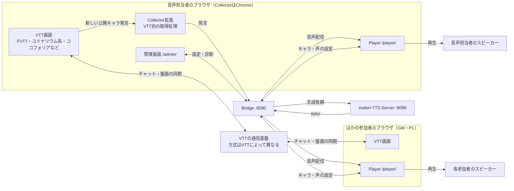

# セットアップガイド

この文書は、誰がどの画面を開き、何がどこへ接続するかを説明します。FVTTとココフォリア、ユドナリウム(Fly,Axe) で、実際のチャット発言の取得から音声生成・Playerでの再生まで確認済みです。ココフォリアの確認版は1.37.5です。

## コンポーネント図


## 接続の全体像

FVTT・ユドナリウム系・ココフォリアなどのVTTで共通して使う構成です。Collector内の取得処理を対象VTTに合わせ、Bridge以降の音声生成・配信を共通化します。各VTTの実装・検証状況は下の対応表を参照してください。

ここでいう「音声担当者」は、CollectorとBridgeを動かし、読み上げの開始・停止を管理する人です。GMでもPLの一人でも担当でき、VTTのGM権限は必要ありません。対象の公開チャットを受信できる人を、同じ入力元につき一人決めます。

URLはBridgeとIrodoriを音声担当者のPCで動かす場合の例です。`127.0.0.1`は、そのURLを開いている端末自身を指します。

| 部品 | 動かす場所・入口 | 役割 |
| --- | --- | --- |
| VTT（FVTT・ユドナリウム系・ココフォリアなど） | 卓参加者（GM・PL）のブラウザで、それぞれのVTTのURLを開く | チャットと盤面を表示する |
| VTTの通信基盤 | VTTごとのサーバーや接続サービス | チャットと盤面を参加者間で同期する。方式は下表を参照 |
| Collector | 音声担当者のChrome拡張 | 音声担当者が開いたVTTの新しい公開キャラ発言をBridgeへ送る |
| Bridge | 音声担当者のPCの`127.0.0.1:8090` | 発言を受け、キャラと声を選び、音声を参加者へ配信する |
| 管理画面 | 音声担当者のブラウザでBridgeの`/admin/` | 接続状態・読み上げ開始停止・参加URLを管理する |
| Irodori-TTS-Server | 音声担当者のPCの`127.0.0.1:8088` | Bridgeから受けたセリフのWAV音声を生成する |
| speech.cpp serve (fork版) | 音声担当者のPCの`127.0.0.1:8088` | Bridgeから受けたセリフのWAV音声を生成する(Irodori-TTS-Serverの代替) |
| Player | 卓参加者全員（GM・PL）のブラウザでBridgeの`/player/` | 音声を再生し、全員でキャラの声を設定する |

### ASCII図

```text
卓のチャット・盤面（VTTごとの方式で同期）:

  [音声担当者のブラウザ: VTT] <---- VTTの通信基盤 ----> [ほかの参加者のブラウザ: VTT]

セリフの読み上げ:

  [音声担当者のChrome: VTT]
           | 新しい公開キャラ発言
           v
  [Collector: VTT別の取得処理] --発言--> [Bridge :8090]
                                            |       ^
                                    生成依頼|       |WAV
                                            v       |
                                       [Irodori :8088]

  [音声担当者のブラウザ: 管理画面] <--設定・診断--> [Bridge :8090]
  [Bridge :8090] --音声--> [音声担当者のブラウザ: Player] --> スピーカー
                  +--音声--> [ほかの参加者のブラウザ: Player] --> 各自のスピーカー
```

### Mermaid図



管理画面とPlayerは、どちらもBridgeが提供するWebページです。追加のサーバープロセスを起動する必要はありません。

VTTの通信基盤の違いは次の通りです。上の図は論理的な接続を示し、実際の同期経路はVTTによって異なります。

| VTT | チャット・盤面の通信方式 |
| --- | --- |
| FVTT | 卓参加者（GM・PL）のブラウザがFVTTサーバーへ接続する |
| ユドナリウム系 | ブラウザ間のP2P通信が中心。SkyWayなどの接続サービスを使い、版や派生に応じて認証用バックエンドも必要になる |
| ココフォリア | 卓参加者（GM・PL）のブラウザがココフォリアのサービスに接続する |

SkyWayバックエンドはユドナリウム系の接続用で、音声生成・配信の共通構成には含まれません。

音声担当者のCollectorがVTT画面から発言を取得してBridgeへ送ります。参加者はVTTとPlayerの両方を開き、Collectorは音声担当者だけが使います。音声担当者もPlayerを開いて聞きます。上記の`127.0.0.1:8090`は音声担当者のPCからしか開けません。インターネット経由の参加者へ音声を届ける場合は、VTT側のオンライン接続に加えて[PlayerのHTTPS公開](online.md)が必要です。

## Collectorとは

Collectorは、このリポジトリの[`tts-bridge/collector/`](../tts-bridge/collector/manifest.json)にある**音声担当者用Chrome/Chromium拡張機能**です。別途作成する必要はありません。VTT本体、ワールド、ゲームシステム、FVTTモジュールやVTTサーバーの設定を変更せず、音声担当者が選んだタブで動きます。

VTTの種類・入力元ID・FVTTのワールドID・対象チャットは自動取得します。ユドナリウムの部屋の識別名など、取得できない項目だけ入力します。初回は拡張の確認コードを管理画面で承認し、以後は保存済みの認証情報を使います。秘密情報はVTTページに渡しません。表示済みの履歴を読み上げず、新しい公開キャラ発言だけを送ります。

対応状況は次の通りです。

| VTT | 現在の状態 |
| --- | --- |
| FVTT 12/13/14 | 新規公開IC発言を取得。14.365 / PF2e 8.3.0 の実FVTTでキャラ発言からPlayerの音声再生まで確認済み。他の版・ゲームシステムは未確認 |
| 通常版ユドナリウム | 元発言IDと公開範囲を安全に取得できる場合だけ動く実験実装。一般的な本番ビルドでは停止する可能性がある |
| ローカルAxe改・開発ビルド | `localhost:4200`の1ブラウザで、公開タブのキャラ発言だけを検出する試験に成功。公開ビルドと複数参加者は未検証 |
| ココフォリア | 1.37.5の実部屋で公開発言の取得から音声生成・Playerでの再生まで確認済み。初期選択はメイン。公開タブを名前で選択し、内部IDで取得する。新着の本文だけを送信し、ダイス結果・ダイスだけの発言・編集・履歴・個別宛先・プライベートタブを除外。声は投稿者IDと発言者名の組で区別 |

取得できないときはポップアップに診断理由を表示します。版や派生ごとの制約・確認範囲は上の対応表を参照してください。ココフォリアの実際の秘匿DM・プライベートグループは未検証です。

## まず1台のPCで動作を確かめる

この手順では音声担当者のPCでbridgeとIrodoriが動きます。VTT自体はインターネット上の別のサーバーでも構いません。

1. Irodori-TTS-Serverを起動し、`http://127.0.0.1:8088/health`が応答することを確認します。Irodori-TTS-Serverの代わりに、speech.cpp の互換モードを搭載したフォーク版 https://github.com/okamichi/speech.cpp も使用可能。
2. `tts-bridge/`で`npm ci`、続いて`npm start`を実行します。Node.js 22.13以上が必要です。
3. 起動ログの管理用リンクを開き、Irodoriの接続状態を確認します。
4. Chromeの拡張機能画面でデベロッパーモードを有効にし、`tts-bridge/collector/`を読み込みます。
5. VTTのタブで拡張を開き「このタブを接続」を押します。初回は管理画面で同じ確認コードを承認し、拡張からもう一度接続します。ユドナリウムでは部屋の識別名を入力し、対象の公開チャットを表示してください。
   ココフォリアではルームチャットを開いて接続します。自動判別・明示選択とも「メイン」が初期値です。「対象チャット」の一覧から別の公開タブを名前で選べます。
6. 管理画面の「参加URLをコピー」で参加URLを共有します。音声担当者自身は「Playerを開く」で参加します。
7. 各参加者がPlayerの音声を有効にし、VTTでキャラとして公開発言します。Playerのキャラ一覧から声を選び、本人だけで試聴して保存します。
8. 管理画面で「読み上げ開始」を押し、新しい発言で再生を確認します。停止中や声未設定時の発言を後から読むことはありません。

FVTTでは「Public as Character」を選びます。「Public as User」やダイスロールは読み上げません。拡張を更新した場合は`chrome://extensions/`で再読み込みし、VTTのタブも再読み込みしてから再接続してください。

ココフォリアでは、キャラクターを選択するか発言者名を設定して、Collectorで選んだ公開タブにセリフを送ります。`1D6`だけなら取得せず、`1D100 ダイスを振ったわ！`なら「ダイスを振ったわ！」だけを読み上げます。ダイス結果は読みません。声は投稿者と発言者名の組で区別するため、名前の変更や投稿者の交代では別のキャラ登録になります。

参加者が別のネットワークにいる場合、PlayerをHTTPSで公開する準備が必要です。[オンライン公開の説明](online.md)を参照してください。

## VTTは自宅、bridgeは別宅に置く場合

その配置は構成上可能ですが、**現コードのCollectorは`127.0.0.1`への送信に限定**されています。別宅のbridgeへ直接接続する設定は、まだ使えません。セットアップ手順が完成したかのように、公開ポートへCollectorトークンを入力しないでください。

この配置を実装するときは、次の接続が必要です。

1. 音声担当者のブラウザ拡張から、別宅bridgeの認証付きHTTPS入力APIへ接続する。拡張の接続先制限と権限設定も変更する。
2. 参加者のPlayerから、別宅bridgeのHTTPS/WSS配信口へ接続する。
3. bridgeからIrodoriへ接続する。Irodoriを別宅bridgeと同じサーバーで動かすか、両者間の私設経路を用意する。
4. 音声担当者が別宅bridgeのローカル管理画面を使うための管理用経路を用意する。現状の管理画面はbridgeサーバーの`127.0.0.1`限定です。

既存の[公開設定例](Caddyfile.example)は**参加者向けPlayerだけ**を転送し、Collector入力APIを転送しません。この別宅配置の公開設定・認証・実機検証は残作業です。


## チャットから声を登録する

Playerからではなく、チャットのメッセージを利用し、各PCが声の登録と削除ができます。

1. 音声担当者がCollectorを接続・承認し、管理画面の「詳細設定」で「チャットによる登録機能を有効にする」をONにします。既定はOFFです。
2. VTTで対象キャラを選び、対象チャネルにたとえば `（ブリッジ声登録）若くて透き通るような女性の声。` と公開発言します。カッコは全角にしてください。事前に別のセリフを発言したり、Playerを開いたりする必要はありません。
3. 登録成功後、読み上げ稼働中なら生成した声で確認文を再生します。Playerでは音声をONにしてください。Discord Botがボイスチャンネルに接続済みなら、そちらでも再生します。
4. 解除するには同じキャラで `（ブリッジ声削除）` と発言します。削除成功の音声はなく、Playerでは「声が未設定」に戻ります。キャラ自体、共有声、TTS側の参照音声は残ります。

処理中はPlayerのキャラ一覧に「生成待ち／生成中／登録中」、失敗時は「登録失敗／削除失敗」と理由が残ります。Playerを後から開いても確認できます。失敗の音声・Discordテキスト通知は行いません。詳しい原因や参照音声IDは管理画面の詳細設定で確認できます。

同じキャラの登録中は再登録やPlayerの保存・キャラ削除を拒否します。チャットの声削除で中断し、その後に再登録できます。他キャラの操作は続行できます。読み上げ停止は進行中の登録も中断しますが、停止中に新しく登録することはできます。完了前に再開すれば確認音声が流れ、停止のまま完了した場合は再開しても遡って流れません。

コマンドは全角括弧で先頭に書きます。説明のない登録、末尾に文字を付けた削除は失敗します。機能OFFや対象外のコマンドをセリフとして読み上げることはありません。ココフォリアでは送信者と表示名で識別するため、キャラ名を変更すると別キャラになります。

再登録すると新しい声プロファイルと参照音声が増えます。キャラ・声プロファイルは各500件までで、自動整理はありません。「声削除」は割り当て解除であり、Playerの「削除」ボタンによるキャラ削除とは異なります。


## 登録済みの声を整理する

Playerの「登録済みの声を整理」を開くと、現在の登録数と、声の名前・使用キャラ・試聴・削除の一覧を表示します。試聴は操作したPlayerだけに再生されます。使っていない声は「削除」を押し、確認して削除できます。使用中の声（無効キャラやDiscordの入退室音声に選択中の声を含む）は削除できません。

削除するとBridgeの登録枠が空き、声の選択肢から消えます。TTSサーバーの参照音声ファイルは残ります。
