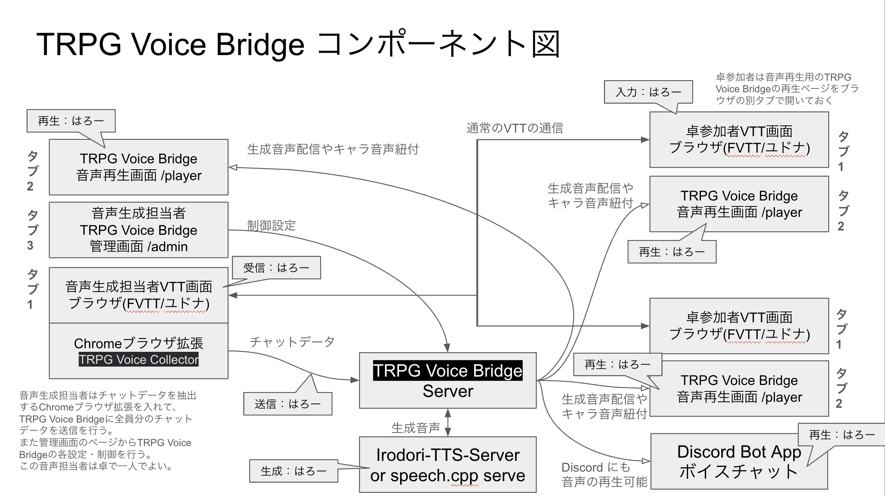
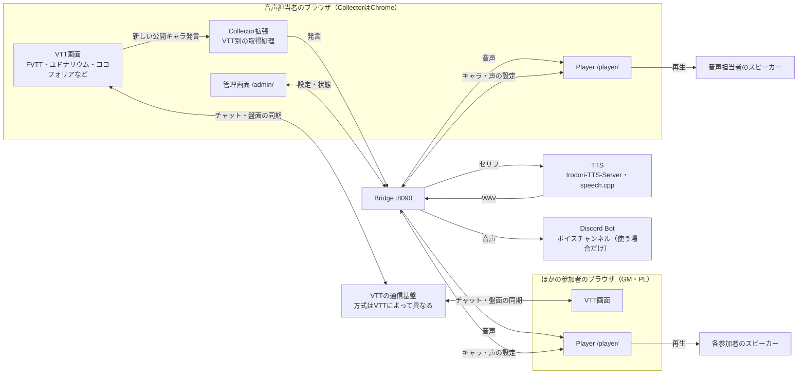

# セットアップガイド

TRPG Voice Bridgeの構成（誰がどの画面を開き、何がどこへつながるか）と、Collectorの動き、声の登録と整理、卓ごとのデータの分け方を説明します。

起動の手順は、ソースから使う場合は[ソースからのビルドと起動](build.md)を、ダウンロードしたアプリの場合は同梱の `README.txt` を見てください。

## 構成



### 音声担当者と参加者

- **音声担当者**は、Bridgeを動かし、管理画面で読み上げの開始・停止を管理します。VTTの既存チャットを取り込む場合だけCollectorも使います。GMでもPLの一人でもかまいません。VTTのGM権限は要りません。同じチャットに対して一人決めてください。
- **参加者**（GM・PL）は、VTTとPlayer、またはChatterサイドパネルを開きます。音声担当者もPlayerで聞きます。既存VTTのチャットを使い、Discordで聞いて声設定を音声担当者に任せる場合は、Playerを開く必要はありません。Player／Chatterのチャットで会話する場合は、Discordで聞く参加者もいずれかのチャット画面を開きます。

### チャットのないVTTで使う

1. 音声担当者がBridgeを起動し、管理画面の「卓の開始」から参加URLを共有します。Collectorの接続は不要です。
2. 参加者は同じBridgeの参加URLをPlayerで開くか、Chatterへ入力して参加し、「＋キャラ作成」で名前を登録します。既存キャラを選ぶこともできます。
3. 「発言キャラ」を選び、メッセージを入力します。Enterで送信、Shift+Enterで改行します。キャラの選択・お気に入り・下書きはブラウザに保存します。
4. 読み上げる場合は「キャラ・声設定」で声を選び、音声担当者が管理画面で読み上げを開始します。各自のブラウザで聞く場合だけ「音声を有効にする」を押してください。

TTS未接続・声未設定・読み上げ停止中でも本文は届きます。履歴は直近7日・卓ごとに最大10,000件を保存し、再参加後も閲覧できます。画面には最新100件までを表示します。長文を音声用に分割してもチャットの表示は1件です。「もう一度再生」は全パートが残っている場合だけ使え、押した本人にだけ流れます。

管理画面の「チャットと本文の共有」をOFFにすると送信・閲覧を停止します。「卓のチャット履歴を消去」で卓全体の本文を消せます。セッション終了や読み上げ停止だけでは履歴は消えません。VTTの隣で使う場合は、[Chatter拡張の導入手順](../tts-bridge/chatter/README.md)に従ってサイドパネルを開けます。Collectorは不要です。

### 使い分けとChatterの導入

| 使いたい機能 | 選ぶもの | 導入する人 |
| --- | --- | --- |
| VTTにある既存チャットの公開発言を取り込む | Collector | 同じチャットにつき音声担当者一人 |
| 拡張を入れずにキャラチャット・声設定・再生を使う | Player | 参加URLを開く参加者 |
| D&D Beyond Mapsなどの隣でチャット・声設定・再生を使う | Chatter | サイドパネルを使う参加者それぞれ |

配布ZIPでは同梱の `chatter/`、ソースから使う場合は `tts-bridge/` で `npm run chatter:build` を実行した後の `tts-bridge/chatter/` をChromeに読み込みます。`chrome://extensions` のデベロッパーモードを有効にし、「パッケージ化されていない拡張機能を読み込む」でそのフォルダーを選んでください。

VTTを開いてChatterのアイコンを押し、管理者から受け取った招待リンクを貼って参加し、接続先へのアクセスを許可します。別PCの参加者には、[公開されたBridgeのURL](online.md)を含む招待リンクを渡してください。パネルを閉じると通信・音声は止まり、再表示すると音声停止状態で履歴を復元します。「退出・接続先を変更」で退出でき、ブラウザ再起動後は招待で再参加します。Player・Chatter・Discordのうち音声を聞く場所を一つ選んでください。

発言は同じ卓に参加するPlayer・Chatterへ共有されます。後から参加した人も保存期間内の履歴を閲覧できます。秘話はありません。本文共有OFF、履歴消去、読み上げ停止は別の操作です。履歴を消しても既に始まった音声配信は止まらないため、必要なら読み上げも停止してください。

### 部品

| 部品        | 動かす場所・入口                           | 役割                                                                                                                  |
| ----------- | ------------------------------------------ | --------------------------------------------------------------------------------------------------------------------- |
| VTT         | 参加者それぞれのブラウザ                   | チャットと盤面を表示する。参加者どうしの同期はVTTの仕組みのまま                                                       |
| Collector   | 音声担当者のChrome拡張                     | 音声担当者が開いたVTTのタブから、新しい公開キャラ発言をBridgeへ送る                                                   |
| Bridge      | 音声担当者のPC（`127.0.0.1:8090`）         | 発言を受けてキャラの声を選び、TTSに音声を作らせて配る                                                                 |
| 管理画面    | 音声担当者のブラウザで、Bridgeの `/admin/` | 接続状態の確認、読み上げの開始・停止、参加URLの発行                                                                   |
| Player      | 参加者のブラウザで、Bridgeの `/player/`    | キャラチャット・音声再生・声設定を行う                                                                            |
| Chatter     | 参加者のChromeサイドパネル | VTTにチャット機能を追加する。キャラチャット・声設定・音声再生を行う。Collector不要 |
| TTS         | 音声担当者のPC                             | セリフの音声（WAV）を作る。別に起動したIrodori-TTS-Serverかspeech.cpp（フォーク版）、またはアプリに同梱したspeech.cpp |
| Discord Bot | Discordのボイスチャンネル                  | Bridgeが作った音声をボイスチャンネルで流す。使う場合だけ                                                              |

管理画面とPlayerは、どちらもBridgeが出すWebページです。別のサーバーを起動する必要はありません。

### つながり方

```text
[音声担当者のChrome: VTTのタブ]
    |
    | 新しい公開キャラ発言
    v
[Collector] --発言--> [Bridge :8090] <--セリフ・音声--> [TTS]
                         |
                         +--設定・状態------ [管理画面]（音声担当者）
                         +--音声・声の設定-- [Player]（音声担当者・参加者）
                         +--音声-----------> [Discord Bot]（使う場合だけ）
```



`127.0.0.1` は、そのURLを開いたPC自身を指します。そのため、`127.0.0.1:8090` は音声担当者のPCでしか開けません。別のPCの参加者にPlayerを使ってもらう場合は、[Playerの公開](online.md)を見てください。

CollectorとBridgeは同じPCで動かしてください。Collectorが接続できるのは、`127.0.0.1` で動くBridgeだけです。

## 卓での流れ

音声担当者：

1. TTSとBridgeを起動し、管理画面を開きます。
2. VTTに入室し、Collectorでそのタブを接続します。初回は、管理画面で接続を承認します。
3. 管理画面の「参加URLをコピー」で、参加URLを参加者に渡します。自分は「Playerを開く」でPlayerを開きます。
4. 「読み上げ開始」を押します。

参加者：

1. 参加URLを開き、Playerの「音声を有効にする」を押します。Discordで聞く人は押さないでください。
2. VTTでキャラとして公開発言すると、Playerの「キャラの声」にそのキャラが表示されます。「声を選ぶ」で声を作り、試聴して「保存」します。試聴の音は本人にしか聞こえません。

読み上げ停止中の発言や、声が未設定のキャラの発言は、あとから読み上げません。管理画面での操作は、[ソースからのビルドと起動](build.md#6-管理画面で卓の準備をする)を見てください。

## Collectorとは

Collectorは、[`tts-bridge/collector/`](../tts-bridge/collector/manifest.json) にある音声担当者用のChrome拡張です。VTT本体やワールド、ゲームシステム、FVTTモジュール、VTTサーバーの設定は変えず、音声担当者が接続したタブだけで動きます。

- VTTの種類、ワールドや部屋、対象のチャットは自動で判別します。判別できない項目（ユドナリウムの部屋の識別名など）だけ入力します。
- 初回は、拡張に表示された確認コードを管理画面で承認します。以後は保存した認証情報で接続します。認証情報はVTTのページには渡しません。
- 接続したあとの新しい公開キャラ発言だけを送ります。表示済みの履歴は読み上げません。本文が500文字を超える発言も読み上げません。
- 取得できないときは、拡張に理由を表示して取得を止めます。
- 拡張を更新したら、`chrome://extensions` で再読み込みし、VTTのタブも再読み込みしてから接続し直してください。

### FVTT

FVTT 12・13・14の、ロードが終わったワールドのタブで接続します。

発言するときは「Public as Character」を選んでください。キャラ（アクター）としての公開発言を読み上げます。「Public as User」、ダイスロール、ささやき（whisper）やブラインドの発言は読み上げません。

### ユドナリウム with Fly

タイトルが「Udonarium with Fly」のページは自動で判別します。公開のチャットタブを、拡張の「対象チャット」で選びます。

キャラとして送った発言を読み上げます。ダイスボット、シークレット、宛先付き、システムの発言は読み上げません。

### ユドナリウム（従来方式）

拡張で「部屋の識別名」を入力します。卓ごとに同じ名前を使ってください。全員に公開されたチャットタブを一つだけ表示して接続します。

発言IDを安全に取得できない版のユドナリウムでは、取得を止めます。

### ココフォリア

ルームのチャットを開いて接続します。対象のチャットは「メイン」が初期値で、拡張の「対象チャット」で、ほかの公開タブを名前で選べます。

- キャラクターを選ぶか発言者名を設定して、選んだタブに送ったセリフを読み上げます。
- ダイス付きの発言は、先頭のコマンドを除いた本文だけを読み上げます。たとえば `1D100 ダイスを振ったわ！` なら「ダイスを振ったわ！」だけを読み上げ、`1D6` だけの発言は読み上げません。ダイスの結果は読み上げません。
- シークレットダイス、宛先付きの発言、編集した発言、プライベートタブの発言は読み上げません。
- 声は、投稿者と発言者名の組で区別します。名前を変えたり、投稿する人が替わったりすると、別のキャラとして扱います。

## チャットから声を登録する

Playerを使わずに、VTTのチャットで声の登録と解除ができます。

1. 管理画面の「5 声と読み上げの調整」で、「チャットによる登録機能を有効にする」をオンにします。最初はオフです。
2. VTTで対象のキャラを選び、対象のチャットで `（ブリッジ声登録）若くて透き通るような女性の声。` のように公開発言します。カッコは全角です。前もってほかのセリフを発言したり、Playerを開いたりする必要はありません。
3. 登録が終わると、読み上げ中なら、その声で確認の文を再生します。Playerで音声を有効にしている人と、接続中のDiscord Botで流れます。
4. 解除するには、同じキャラで `（ブリッジ声削除）` と発言します。Playerでは「声が未設定」に戻ります。解除の確認音声はありません。キャラ自体、声、TTS側の参照音声は残ります。

- コマンドは発言の先頭に書きます。説明のない登録や、後ろに文字を付けた削除は失敗します。機能がオフのときや対象外のチャットでは、コマンドをセリフとして読み上げることはありません。
- 進み具合は、Playerのキャラ一覧に「生成待ち」「生成中」「登録中」と表示します。失敗すると「登録失敗」「削除失敗」と理由が残ります。失敗の音声やDiscordへの通知はありません。詳しい原因は、管理画面の「チャットによる声登録」で確かめられます。
- 同じキャラの登録中は、そのキャラの再登録、Playerでの保存、キャラの削除はできません。`（ブリッジ声削除）` で中断できます。ほかのキャラは操作できます。
- 読み上げを停止すると、進行中の登録も中断します。停止中でも新しい登録はできます。確認の音声は、登録が終わる前に読み上げを再開した場合だけ流れます。
- 登録し直すたびに、声と参照音声が増えます。キャラと声はそれぞれ500件までで、自動では整理しません。`（ブリッジ声削除）` は声の割り当てを外すだけで、Playerの「削除」でキャラを消すのとは違います。

## 登録済みの声を整理する

Playerの「登録済みの声を整理」を開くと、登録数と、声の名前・使っているキャラ・試聴・削除の一覧を表示します。試聴の音は、操作した人のPlayerだけで鳴ります。

使っていない声は「削除」で消せます。使用中の声（無効にしたキャラや、Discordの入室・退室メッセージに選んでいる声を含む）は消せません。消すとBridgeの登録枠が空き、声の選択肢からなくなります。TTS側の参照音声のファイルは残ります。

## 卓ごとにデータを分ける

管理画面の「0 起動設定」で保存先を変えて「保存して再起動」を押すと、Bridgeがその保存先で再起動します。前の保存先のデータは移動も削除もしないので、保存先を戻せば前の卓に戻れます。この設定は次に起動したときも使われます。

起動するときに保存先を指定することもできます。指定した保存先は「0 起動設定」より優先され、「0 起動設定」では変更できなくなります。

`npm start` では、`TTS_DATA_DIR` を卓ごとに変えて起動します。初期値も卓ごとに用意する場合は、`TTS_CONFIG_FILE` も指定します。

```sh
TTS_DATA_DIR=~/trpg/campaign-a/data TTS_CONFIG_FILE=~/trpg/campaign-a/config.json npm start
```

ダウンロードしたアプリや、自分でビルドした実行ファイルでは、`--data-dir` を卓ごとに変えます。アプリでは、同じ保存先のBridgeを同時に二つ起動することはできません。

```sh
./trpg-voice-bridge --data-dir ~/trpg/campaign-a/data
```

保存先には、次のものが入ります。

- `bridge.sqlite`：設定・キャラ・声・紐付け・入力元・認証情報・発言の記録
- `audio/`：一時的なWAV
- `discord.json`：Discordの設定
- `runtime.json`、`voices/`：内蔵TTSの起動設定と参照音声（アプリの場合）

外部TTSを使う場合は、TTS側の参照音声の保存先（speech.cppの `--voices-dir` など）も卓ごとに分けることをおすすめします。内蔵TTSの参照音声は保存先の `voices/` に入るので、別に指定する必要はありません。

`TTS_CONFIG_FILE` の内容が使われるのは、その保存先に `bridge.sqlite` を初めて作るときと、管理画面の「設定を初期値に戻す」を押したときだけです。「設定を初期値に戻す」で戻るのはキャラ・声・紐付けで、認証情報と接続設定は残ります。使い始めた卓では、ファイルを書き換えて再起動しても反映されません。

参加者はPlayerの「Chatterの導入について」から拡張のZIPをダウンロードして展開できます。表示された手順でChromeに読み込んでください。
