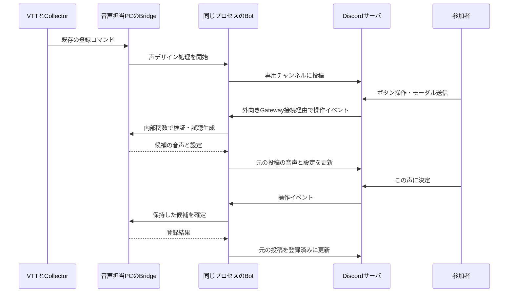

# VTTチャットを入口にしたDiscord声デザイン 実装計画

## 目的と互換性

参加者がVTTで `（ブリッジ声登録）イケオジボイス。` と発言すると、Collectorが既存経路でBridgeに送り、Discordの専用テキストチャンネルに声づくりメッセージを投稿する。試聴・設定変更・再生成を繰り返し、「この声に決定」で聴いた候補の原本を参照音声として登録し、発言キャラクターに割り当てる。

既存のPlayer、Chatter、Collector、チャット即時登録・削除、Discordボイス読み上げを維持する。追加モードは既定で無効。チャット登録自体の既存許可設定も引き続き必要。Discord試聴モードの有効時に限り、同じ登録コマンドを試作開始として扱う。Bot障害時に勝手に即時登録へ切り替えない。既存の `（ブリッジ声削除）` を維持し、`（ブリッジ声解除）` を別名として追加する。

## 利用フロー

1. 音声担当者が既存のBotをログインさせ、管理画面で専用テキストチャンネルとDiscord試聴モードを設定する。VCへの接続は必須にしない。
2. VTT登録コマンドを既存の検証・キャラクター解決・重複排除に通す。
3. 専用チャンネルに「生成中」のメッセージを１件投稿。Bridgeで初期候補を生成する。
4. 同じメッセージに音声と設定概要、編集・再生成・確定・取消ボタンを表示する。
5. 編集はDiscordのモーダルで実施。編集後は未試聴として確定を無効化し、再生成後に再び確定可能にする。
6. 再生成のたびに同じ投稿の添付音声を置換する。古い候補を追記し続けない。
7. 確定後は生成し直さず、保持中のWAV原本を既存の参照音声登録処理に渡す。成功してから現在の声を切り替える。
8. 投稿を登録済みに更新する。失敗・期限切れ・取消・アプリ再起動では既存の登録音声を維持する。

## UI対応表

HTMLや任意の `<audio>` / `<video>` をチャットに埋め込むことはできない。Discordの通常メッセージ＋音声添付＋ボタンを使う。音声添付のインライン再生UIはPC・スマホで実機確認する。編集不可の専用ボイスメッセージは使わない。

| Playerの機能                       | Discordでの実装                                    |
| ---------------------------------- | -------------------------------------------------- |
| 声の名前・説明・速度・試聴セリフ   | 基本設定モーダル（4項目）                          |
| seed・steps・3種のCFG              | 詳細設定モーダル（5項目）                          |
| 登録済み声の選択                   | キャンセル可能な選択モーダルで設定を下書きにコピー |
| 参照音声の選択                     | キャンセル可能な選択モーダル                       |
| 同じ設定で試聴                     | 変更を反映し再生声（未変更時は無効）               |
| 別の声を試す                       | 詳細設定のseedを変更後、再生成                     |
| 参照音声の登録・キャラへの割り当て | この声に決定（IDは安全な形式で自動採番）           |
| キャラ名変更・読み上げ有効無効     | 既存Player／管理画面を使用。声づくりでは変更しない |

試聴音声はチャンネル閲覧者に公開される。「自分だけで試聴」とは異なる。最初の実装は既存Playerと同じ共同編集モデルとし、指定サーバ・チャンネルの参加者が操作できることを画面に明記する。VTT名とDiscord名から所有者を推測しない。本人限定運用は将来、管理者が明示的に対応付ける機能として追加する。

## 通信と実装構造

BotはDiscordサーバ上ではなくBridgeと同じNodeプロセスで動く。`interactionCreate` を追加し、Gatewayイベントを受ける。公開HTTPエンドポイント、ポート開放、SkyWay、独自中継サーバは不要。生成開始などは3秒以内に受付応答を返し、以後はBotとして元の投稿を編集する。モーダルを開く操作には即座にモーダルで応答する。

既存の `ChatVoices` に任意のデザイン処理を差し込む。試作の完了後は既存の参照登録・キャラ競合検査・保存を共用する。Discordフォームからの確定では確認音声を配信せず、登録完了の表示だけにする。従来の即時登録の確認音声配信は維持する。試聴はPlayerと同じ `engine.preview`、入力検証は `voiceSchema`、参照音声登録は `ReferenceVoices` を使う。PlayerのHTTP認証経路は変更しない。

## 状態・競合・寿命

- 下書きはコマンドID、対象キャラ、設定、試聴セリフ、候補版番号、原本WAV、Discord投稿を保持する。トークンや管理者資格をボタンに含めない。
- 1キャラ1件の既存登録ロックを継続。全体の同時下書きは4件まで、期限は開始から10分。音声は既存の1件25MiB上限の範囲に制限する。
- `designing` 状態を既存コマンド履歴に追加。再起動で未完了コマンドは失敗扱いにし、古いボタンは期限切れとして拒否する。無制限に候補履歴を保持しない。
- モーダル・ボタンに版番号を付ける。編集や再生成で更新し、古いフォームの送信、連打、遅れて到着した生成結果を拒否する。
- 登録・再生成中は重複操作を抑止。取消と終了はAbortSignalで伝える。停止、解除、設定変更、Bot終了時は下書きを終了する。
- 登録先の変更・キャラ削除・プロバイダー変更などは既存の検証とスナップショット比較で検出する。
- Discordへのアップロード失敗時は確定不可。現在の声は変えず、投稿更新の失敗を管理画面にも表示する。
- Discordへの添付とBridgeの原本保持は別。期限切れ時には可能な限り投稿の音声を外すが、Discordや利用者が保持したコピーの消去は保証しない。

## 入力・権限

指定サーバ・チャンネル・Bot自身の投稿に紐付く操作だけを処理する。共同編集方針を表示する。入力はフィールドの許可リスト、長さ、数値範囲で検証。seedは文字列のまま扱う。メンションは `allowed_mentions` 相当で無効化。入力からパス、任意URL、シェル命令を作らない。エラーにBotトークンやプロバイダーの秘密情報を出さない。

Botには専用チャンネルの閲覧、メッセージ送信、ファイル添付、履歴閲覧を付与する。管理者権限やMessage Content Intentを追加要求しない。音声形式はまずWAVを使用し、添付上限に収まらなければ既存のOgg Opusエンコードを使用。実機で再生互換性を確認する。MP3エンコーダーの追加は初期実装に含めない。

## 実装段階

1. 既存登録経路の任意フックと `designing` 状態、解除別名、回帰テスト。
2. Bot専用の下書き管理・フォーム生成・操作受付・同一投稿更新・期限と終了処理。
3. Discord拡張設定と管理画面に専用チャンネル・試聴モードを追加。既存ボイス接続と分離。
4. 生成・再生成・確定・競合・異常系の自動テストと既存機能の回帰確認。
5. 利用ドキュメント更新、PC／スマホ実機確認。実アカウントが利用できない場合は未確認事項を明記する。

## 受け入れ条件

- モード無効時の既存即時登録、削除、Player、Chatter、Discord読み上げが従来どおり動く。
- 有効時は登録コマンドから専用チャンネルへの投稿が1件だけ作られ、確定までは声が変わらない。
- 基本・詳細・既存声・参照声を設定でき、同じ投稿内で再生成を繰り返せる。
- 確定に使うWAVが最後に公開した候補の原本と一致し、二重登録しない。
- 指定外チャンネル、古い版番号、不正な値、メンションを含む入力、連打、期限切れを適切に扱う。
- 生成／投稿／登録失敗、Bot切断、解除、停止、終了で既存声を壊さず、終了処理が待ち続けない。
- 自動テストではDiscordをモックし、実機確認では音声のインライン再生・差し替え・モーダル操作・権限不足を確認する。

## 実装・検証記録

2026-10-23：上記の追加モード、Discordフォームと同一投稿更新、管理画面設定、解除別名、寿命と競合制御を実装。既存Player／ChatterのHTTP処理は変更せず、音声生成・参照登録の共通処理を使用した。

- 単体・統合テスト：183件成功（`npm test`）。
- Discord管理画面のブラウザテスト：4件成功。
- Prettierと差分の空白チェック：成功。
- 実Discordへの投稿、PC／スマホでの音声インライン再生、実サーバでの権限設定：未検証。自動テストはDiscordの通信をモックしている。
- 参加者本人への限定は行わず、計画どおり指定チャンネルでの共同編集。本人限定運用は別機能として残す。

## 仕様参照

- [Discord Components](https://docs.discord.com/developers/components/reference)
- [Interactionsの受信と応答](https://docs.discord.com/developers/interactions/receiving-and-responding)
- [メッセージ更新と添付差し替え](https://docs.discord.com/developers/resources/message#edit-message)

## 操作性の修正

既存の声・参照音声の選択をモーダルに変更した。閉じるだけでは下書きも試聴音声も変えない。候補の続きはDiscordの制約上、閉じられる案内ボタンから別モーダルで開く。再生成は「変更を反映し再生声」とし、設定未変更時は無効。「別の候補を生成」ボタンは削除し、seedの変更は詳細設定にまとめた。今ある音声の聴き直しは添付の再生ボタンを使う。生成待ち・生成中は音声の代わりに進行表示と受付からの相対時間を表示し、完了時に音声添付へ置き換える。Discord声デザインの初期セリフのみ「これからこの声でお話しします。」に短縮。フォーム関連テスト11件成功。実Discordクライアントでの確認は別途必要。
